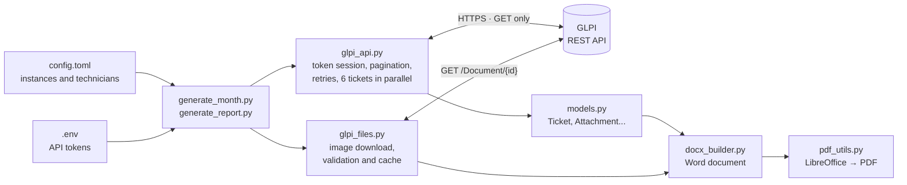
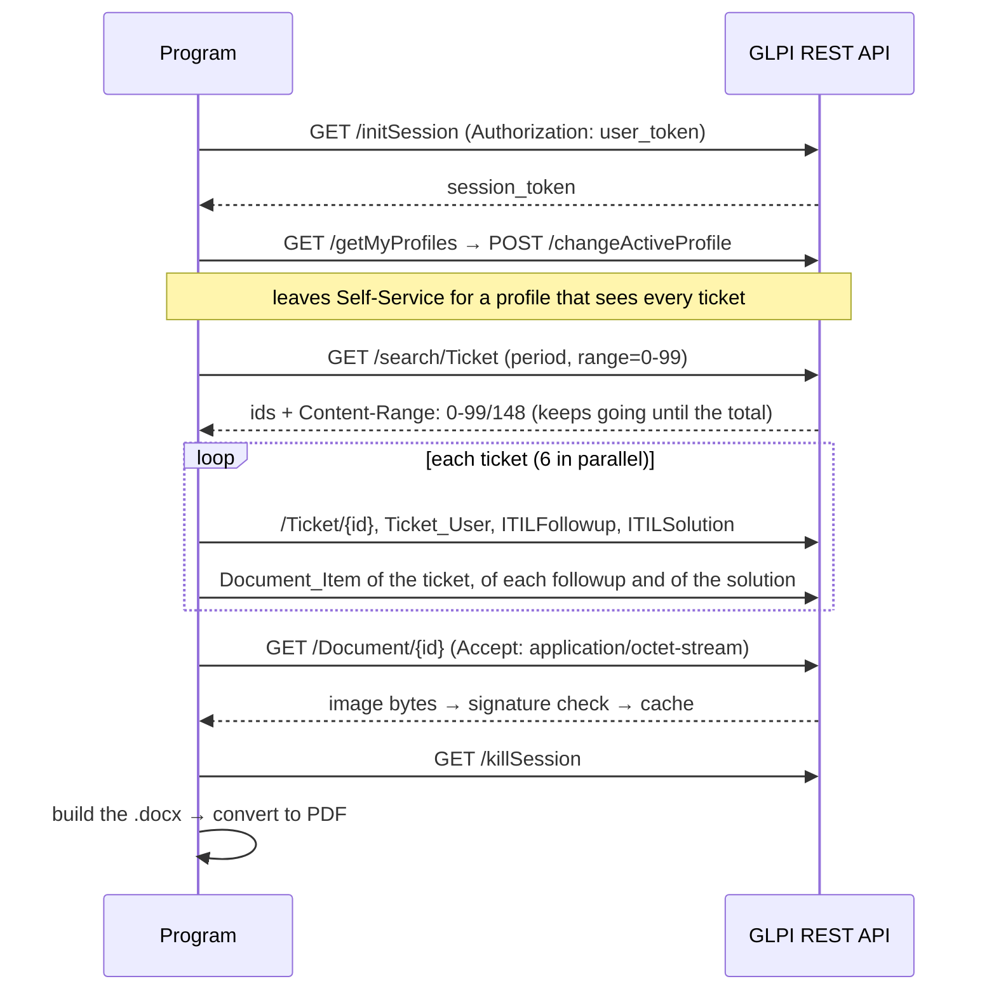

# glpi-evidence-report

**English** | [Português](README.pt-BR.md)

Generates the monthly "evidence book" of an IT support contract (every ticket handled by each technician, with history, solution and attached screenshots) in Word and PDF, straight from the GLPI REST API.


[](https://github.com/JoseEnriq/glpi-evidence-report/actions/workflows/tests.yml)

| Cover with a summary per technician | Table of contents with links | Ticket with timeline and evidence |
|---|---|---|
|  |  |  |

The images and the [sample PDF](docs/sample/evidence_report_sample.pdf) come from demo mode, with fictitious data. The report itself is in Portuguese because it was built for a Brazilian contract; the code is in English.

## Why I built it

At work, our team has to prove every month the support it delivered under a service contract. The document used to be assembled from GLPI's notification e-mails, and a screenshot only made it in if someone had moved the right e-mail to the right folder. It was slow, it depended on one person, and many images were lost, especially the ones attached to followups and solutions instead of the ticket itself.

## How it works

The program talks to the GLPI REST API, read-only:

1. opens a session with an API token, so no password is stored;
2. searches the period's tickets, paginating, and fetches 6 tickets in parallel;
3. collects attachments from the ticket, its followups and its solution, without duplicates;
4. downloads the images into a disk cache, checking each file's signature;
5. builds the Word document with python-docx and converts it to PDF with headless LibreOffice.

One command generates last month's reports for every configured GLPI instance.



What happens with one GLPI, from login to document:



## Design decisions

- **Attachments from three origins.** Most missing images were attached to followups and solutions, so I query `Document_Item` for each of them, not only for the ticket.
- **Validate the bytes, not the response.** A document download can come back as an HTML login or error page with status 200. I check the PNG/JPEG/GIF/BMP signature before saving anything as an image.
- **Trust `Content-Range`, not the page size.** Some servers return smaller pages than requested, so pagination follows the total the server reports.
- **Least privileged profile.** Login usually lands on Self-Service, which cannot see other users' tickets, so the program switches to the least privileged profile that can.
- **6 workers on purpose.** Each ticket costs about 12 requests; a small thread pool and a cache of users and categories keep it fast without overloading GLPI.

The full table, pointing to the code, and the module layout are in [docs/arquitetura.md](docs/arquitetura.md#decisões-técnicas) (in Portuguese).

## Results

From using it in production at work:

- the monthly reports for all our GLPI instances come out of a single command, with no manual step, and can run from Windows Task Scheduler;
- images attached to followups and solutions now make it into the report;
- before dropping database access, I checked the API output field by field against a direct database read.

## Run the demo

No GLPI needed: a simulated server answers at the HTTP layer, so the real program runs end to end.

```bash
git clone https://github.com/JoseEnriq/glpi-evidence-report.git
cd glpi-evidence-report
python -m venv .venv
.venv\Scripts\activate          # Linux/macOS: source .venv/bin/activate
pip install -r requirements.txt
python demo.py
```

The `.docx` and `.pdf` end up in `demo_output/`. The PDF needs [LibreOffice](https://www.libreoffice.org/) installed; without it you get only the `.docx`.

## Use it with your GLPI

You need the REST API enabled with token login and a user token with a read-only profile. Fill in `config.toml` and `.env` from the example files and run `python diagnose_api.py` to check access. Setup, commands and troubleshooting are in [docs/uso.md](docs/uso.md) (in Portuguese).

## Tests

Run `pip install -r requirements-dev.txt` and then `pytest`. The suite covers the pure functions and the end-to-end flow against the simulated GLPI (a transient 503, an HTML page served as an image, pagination past the server's limit) and runs on Ubuntu and Windows in GitHub Actions.

---

© 2026 JoseEnriq. All rights reserved. A portfolio piece: feel free to read the code and run the demo, but do not copy, modify or redistribute it without permission.
