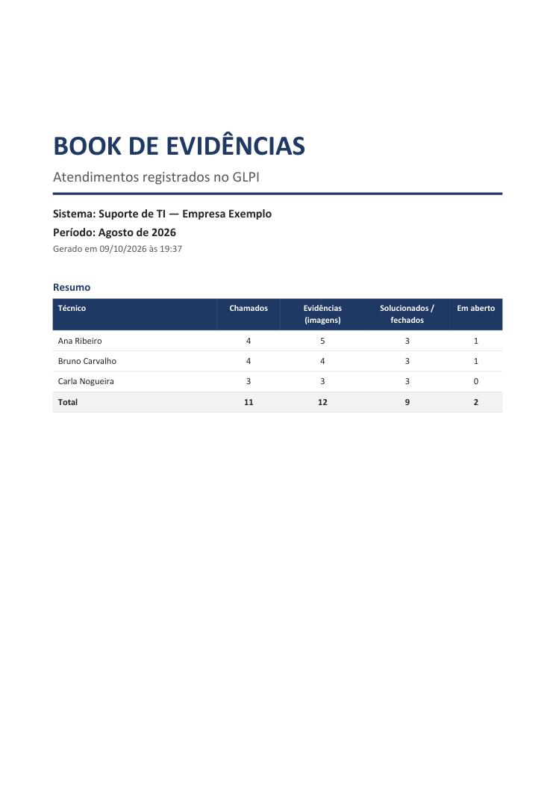
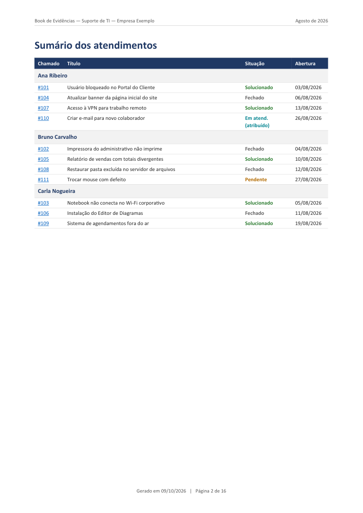
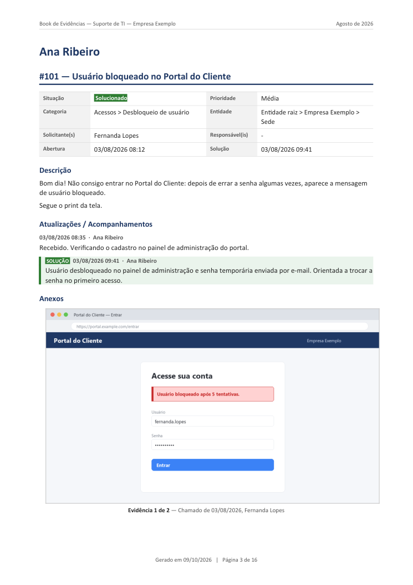
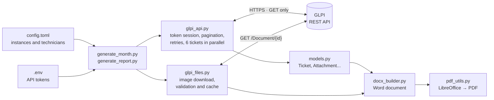
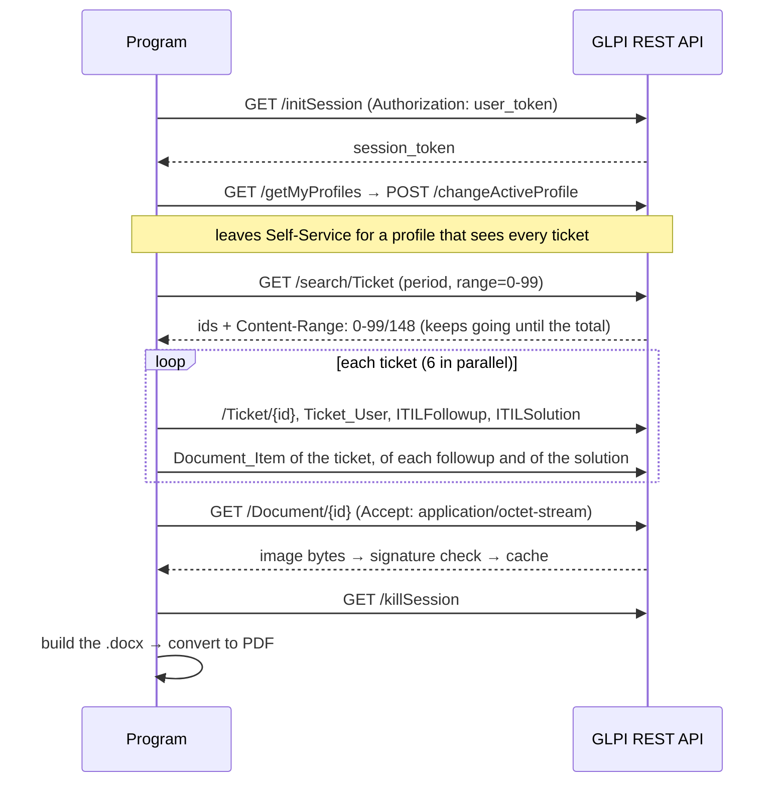

# glpi-evidence-report

**English** | [Português](README.pt-BR.md)

**Evidence report generator for IT support tickets, built on the GLPI REST API.**
It reads the tickets of a period, gathers description, history, solution and attached screenshots, and produces an "evidence book" in Word and PDF — with no manual steps.


| Cover with a summary per technician | Table of contents with links | Ticket with timeline and evidence |
|---|---|---|
|  |  |  |

> All images and the [sample PDF](docs/sample/evidence_report_sample.pdf) were produced by **demo mode**, with fictitious data and screenshots. The generated report is in Portuguese because it was built for a Brazilian contract; the code is in English.

---

## The problem

An IT team working under a service contract has to prove, every month, the support it delivered: a document (the *evidence book*) with every ticket handled by each technician — description, history, solution and the attached screenshots.

The previous process depended on e-mail: images only made it into the document if someone manually moved GLPI's notification e-mails into a mail folder. It was slow, depended on one person, and **many images were left out** — especially the ones attached to followups and solutions rather than to the ticket itself.

## The solution

A Python program that talks directly to the **GLPI REST API**, read-only:

1. opens a session with an **API token** (no stored passwords);
2. finds the period's tickets, with **pagination** and **6 tickets fetched in parallel**;
3. collects attachments from **three origins** — ticket, followups and solutions — without duplicates;
4. downloads the images with a **disk cache** and **file signature validation** (an error page never becomes an "image");
5. builds the document in **Word** (python-docx) and converts it to **PDF** (headless LibreOffice).

A single command generates last month's reports for every configured GLPI; a `.bat` file allows scheduling it on Windows.

## Results

- A manual process replaced by **fully automated generation**: the monthly reports for several GLPI instances are produced in **about 2 minutes**.
- **Recovers images from followups and solutions**, not only from the ticket — the "no image available" cases of the old process dropped to zero.
- Before going API-only, the data was **validated field by field** against a direct database read (hundreds of identical tickets, including the order of names); after that, database access was removed.
- **Security**: no stored passwords, only revocable tokens; the program only reads from GLPI; API access can be restricted to the authorized machine's IP.

## Architecture



What happens with one GLPI, from login to document:



### Technical decisions

| Topic | How it was solved | Where |
|---|---|---|
| Authentication | API token exchanged for a temporary `session_token`; no password | `glpi_api.ApiClient._authenticate` |
| Profile without access to attachments | automatic switch of the session's active profile (Self-Service → central profile) | `_switch_to_central_profile` |
| Large lists | pagination following the `Content-Range` header, even when the server returns smaller pages than requested | `ApiClient.get_list` |
| Missing images | attachments of the ticket **+** followups **+** solutions, without duplicates | `GlpiSource._attachments` |
| Slowness (~12 requests per ticket) | in-memory cache of users/categories + `ThreadPoolExecutor` with 6 threads | `GlpiSource.fetch_tickets` |
| Transient failures | retries network errors and 5xx (growing wait); does not retry 4xx; one bad ticket does not bring the batch down | `ApiClient._get`, `fetch_tickets` |
| "Image" that is really an error page | checks the leading bytes (PNG/JPEG/GIF/BMP) before saving | `image_utils.detect_mime` |
| Repeated downloads | disk cache keyed by document id (GLPI documents are immutable) | `glpi_files.DocumentDownloader` |
| Tickets in the trash | the API search already excludes them | `find_ticket_ids` |
| Same text on every run | actors sorted by the id of their link to the ticket | `GlpiSource._actors` |
| Caption separated from its image | "keep with next" on the image; widow/orphan control | `docx_builder._insert_attachments` |
| "Page X of Y" in a different font size | Word field built in parts, all with the same formatting | `docx_builder._insert_field` |
| PDF open in a viewer | detects the lock and saves under another name | `pdf_utils._move_avoiding_locked_target` |

## Tech stack

- **Python 3.11+** — `requests`, `python-docx`, `python-dotenv`, `tomllib`, `concurrent.futures`, `dataclasses`
- **GLPI REST API** — token session, profile switch, search with criteria, pagination, document download
- **Word (OOXML)** — besides python-docx, hand-built XML elements for borders, shading, page fields, bookmarks and internal links
- **Headless LibreOffice** — PDF conversion with lossless images, clickable links and bookmarks
- **pytest** — tests for the pure functions and end to end against a simulated GLPI

## Run the demo (no GLPI needed)

Demo mode generates a complete report with fictitious data. The real program runs end to end — only the server is simulated, at the HTTP layer: a `requests` transport adapter answers like the GLPI API (login, profile switch, pagination, a transient 503, an attachment that returns HTML instead of an image...). See [`simulator/fake_glpi.py`](simulator/fake_glpi.py).

```bash
git clone https://github.com/JoseEnriq/glpi-evidence-report.git
cd glpi-evidence-report
python -m venv .venv
.venv\Scripts\activate          # Linux/macOS: source .venv/bin/activate
pip install -r requirements.txt
python demo.py
```

Expected output (abridged):

```text
13 ticket(s) found in the given period.
Fetched ticket #101 — Usuário bloqueado no Portal do Cliente
...
Technician filter: kept 11 of 13 ticket(s).
Images: 12 available (12 downloaded now, 0 from cache, 1 failed).
[WARNING] Document 514 not downloaded: the downloaded content is not an image (missing permission or error page?)
Evidence report generated: demo_output\evidence_report_demo_2026-08.docx
PDF generated: ...\demo_output\evidence_report_demo_2026-08.pdf
```

The `.docx` and `.pdf` end up in `demo_output/`. The PDF is only generated if [LibreOffice](https://www.libreoffice.org/) is installed (without it you get just the `.docx`). Run it again to see the cache at work (`0 downloaded now, 12 from cache`); `python demo.py --clean` starts over.

## Use it with your GLPI

### 1. In GLPI (once, by an administrator)

In **Setup > General > API**:

- **Enable Rest API:** Yes
- **Enable login with external token:** Yes (login with credentials can stay off)
- An active **API client** that accepts the machine running the program (ideally restricted to its IP)

The token's user needs a profile that can see every ticket and attachment. Recommended: a **service account with a read-only profile** (Observer or Read-Only, on the root entity, recursive).

### 2. Local configuration

```bash
copy config.example.toml config.toml   # Linux/macOS: cp
copy .env.example .env
```

- **`config.toml`** — one section per GLPI: display name, URL and the technicians included in the monthly report.
- **`.env`** — each instance's API token (`GLPI_<KEY>_API_USER_TOKEN`). In GLPI: *My settings > Remote access keys > API token*. Both files are in `.gitignore`.

### 3. Commands

```bash
python diagnose_api.py                                # checks API, allowed IP, token and profile of each GLPI
python generate_month.py                              # last month's reports for every instance (.docx + .pdf)
python generate_month.py --month 2026-08 --instances main
python generate_report.py --instance main --period 2026-08-01 2026-08-31 --technician "Ana Ribeiro" --pdf
python generate_report.py --instance main --ids 101,105 --pdf
```

On Windows, `generate_month.bat` runs `generate_month.py` and can be scheduled with Task Scheduler.

### Troubleshooting

| Message | Likely cause | What to do |
|---|---|---|
| connection error / no answer | outside the GLPI network | connect to the network / VPN |
| `Missing API token` / `rejected the login` | empty, wrong or regenerated token | regenerate the API token and update `.env` |
| `ERROR_NOT_ALLOWED_IP` | machine IP not allowed (watch out for NAT/proxy: what counts is the IP the server sees) | adjust the API client |
| `API disabled` | API turned off in GLPI | Setup > General > API |
| `LibreOffice not found` | LibreOffice missing | install it or set `LIBREOFFICE_PATH` in `.env` |

## Tests

```bash
pip install -r requirements-dev.txt
pytest
```

The tests cover the pure functions (pagination, image signature, HTML → text, configuration, technician filter) and the end-to-end flow against the simulated GLPI: login and profile switch, rejected token, pagination beyond the server's page limit, trash exclusion, attachments from the three origins, retry after a 503, HTML rejected as an image, and cache reuse.

## Project layout

```text
├── generate_month.py / .bat   monthly reports for every instance
├── generate_report.py         the flow of one report (CLI)
├── glpi_api.py                everything that talks to the GLPI REST API
├── glpi_files.py              image download with validation and cache
├── models.py                  data model and GLPI code translation
├── docx_builder.py            builds the Word document (does not talk to GLPI)
├── pdf_utils.py               .docx → PDF via LibreOffice
├── image_utils.py             real image type from its signature
├── config.py                  reads config.toml
├── diagnose_api.py            checks API access
├── demo.py                    demo mode
├── simulator/                 simulated GLPI, fictitious data and images
├── tests/                     pytest
└── docs/                      screenshots and sample PDF
```

## Security

- **Read-only.** Every request is a `GET`, except `initSession`/`killSession` and `changeActiveProfile`, which only changes the active profile of the program's own session and writes nothing to GLPI.
- **No passwords.** Only API tokens, revocable at any time; they live in `.env`, outside version control.
- **Least privilege.** A service account with a read-only profile and an API client restricted to the machine's IP are recommended.

## License

[MIT](LICENSE)
