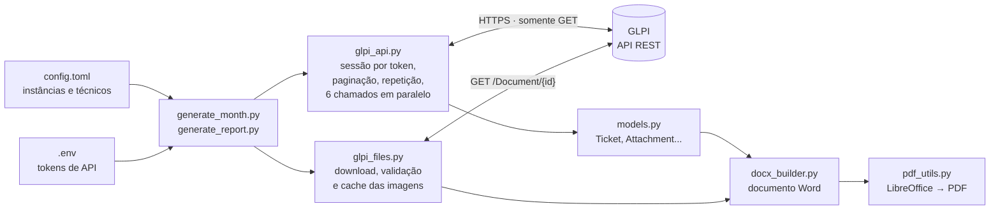
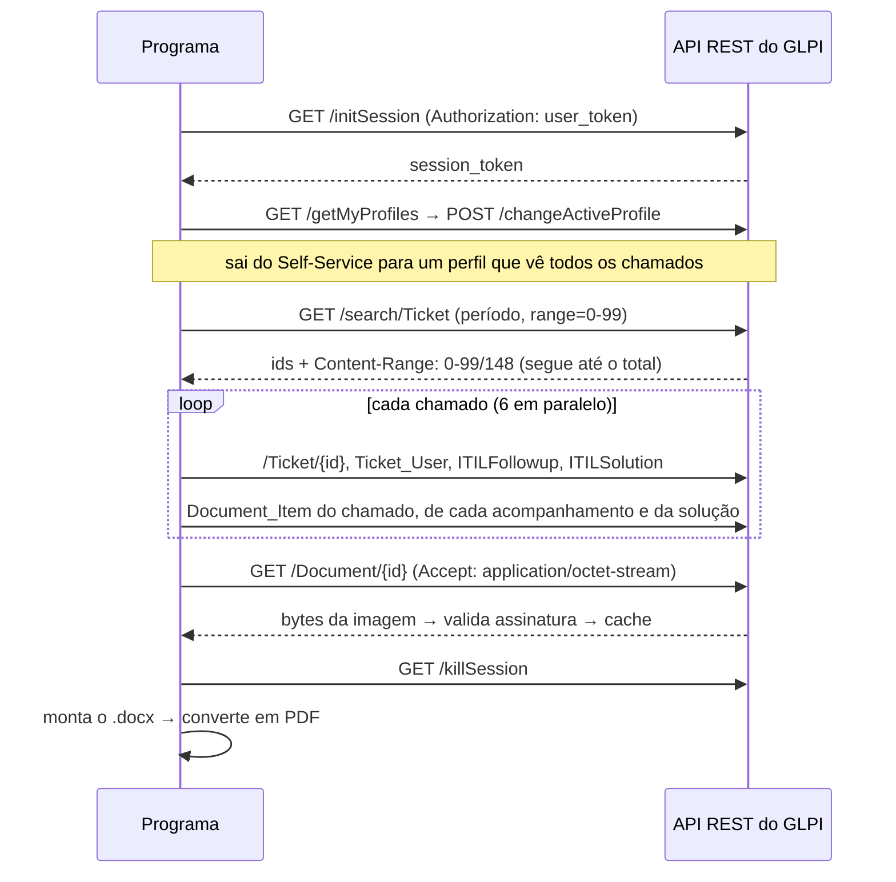

# glpi-evidence-report

[English](README.md) | **Português**

**Gerador de relatório de evidências de atendimento a partir da API REST do GLPI.**
Lê os chamados de um período, junta descrição, histórico, solução e as imagens anexadas, e monta um "book de evidências" em Word e PDF — sem passo manual.


| Capa com resumo por técnico | Sumário com links | Chamado com linha do tempo e evidências |
|---|---|---|
|  |  |  |

> Todas as imagens e o [PDF de exemplo](docs/sample/evidence_report_sample.pdf) foram gerados pelo **modo demonstração**, com dados e "prints" fictícios. O book gerado é em português porque foi feito para um contrato brasileiro; o código é em inglês.

---

## O problema

Uma equipe de TI que presta serviço por contrato precisa comprovar, todo mês, os atendimentos feitos: um documento (o *book de evidências*) com cada chamado atendido por cada técnico — descrição, histórico, solução e as imagens anexadas.

O processo anterior dependia do e-mail: as imagens só entravam no documento se alguém movesse à mão as notificações do GLPI para uma pasta do cliente de e-mail. Era lento, dependia de uma pessoa e **muitas imagens ficavam de fora** — principalmente as anexadas aos acompanhamentos e à solução, e não ao chamado em si.

## A solução

Um programa em Python que fala direto com a **API REST do GLPI**, em modo somente leitura:

1. abre uma sessão com um **token de API** (sem senha guardada);
2. busca os chamados do período, com **paginação** e **6 chamados em paralelo**;
3. reúne os anexos das **três origens** — chamado, acompanhamentos e soluções — sem duplicar;
4. baixa as imagens com **cache em disco** e **validação da assinatura do arquivo** (uma página de erro nunca vira "imagem");
5. gera o documento em **Word** (python-docx) e converte em **PDF** (LibreOffice headless).

Um único comando gera os books do mês anterior de todos os GLPIs configurados; um `.bat` permite agendar no Windows.

## Resultados

- Processo manual substituído por **geração 100% automática**: os books mensais de várias instâncias do GLPI saem em **cerca de 2 minutos**.
- **Recupera as imagens de acompanhamentos e soluções**, não só as do chamado — zerou os casos de "sem imagem disponível" que o processo anterior tinha.
- Antes de adotar só a API, os dados foram **validados campo a campo** contra uma leitura direta do banco de dados (centenas de chamados idênticos, inclusive a ordem dos nomes); depois disso o acesso ao banco foi removido.
- **Segurança**: nenhuma senha guardada, só tokens revogáveis; o programa só lê o GLPI; o acesso à API pode ser restrito ao IP da máquina autorizada.

## Arquitetura



O que acontece com um GLPI, do login ao documento:



### Decisões técnicas

| Ponto | Como foi resolvido | Onde |
|---|---|---|
| Autenticação | token de API trocado por um `session_token` temporário; nenhuma senha | `glpi_api.ApiClient._authenticate` |
| Perfil sem acesso aos anexos | troca automática do perfil ativo da sessão (Self-Service → perfil central) | `_switch_to_central_profile` |
| Listas grandes | paginação seguindo o cabeçalho `Content-Range`, mesmo que o servidor devolva páginas menores que as pedidas | `ApiClient.get_list` |
| Imagens faltando | anexos do chamado **+** acompanhamentos **+** soluções, sem duplicar | `GlpiSource._attachments` |
| Lentidão (~12 pedidos por chamado) | cache em memória de usuários/categorias + `ThreadPoolExecutor` com 6 threads | `GlpiSource.fetch_tickets` |
| Falhas temporárias | repete erro de rede e 5xx (espera crescente); não repete 4xx; um chamado com erro não derruba o lote | `ApiClient._get`, `fetch_tickets` |
| "Imagem" que é página de erro | confere os bytes iniciais (PNG/JPEG/GIF/BMP) antes de salvar | `image_utils.detect_mime` |
| Downloads repetidos | cache em disco por id do documento (documento do GLPI é imutável) | `glpi_files.DocumentDownloader` |
| Chamados da lixeira | a busca da API já os exclui | `find_ticket_ids` |
| Texto sempre igual entre execuções | participantes ordenados pelo id do vínculo ao chamado | `GlpiSource._actors` |
| Legenda separada da imagem | "manter com o próximo" na imagem; controle de linhas órfãs | `docx_builder._insert_attachments` |
| "Página X de Y" em tamanho diferente | campo do Word montado em partes, todas com a mesma formatação | `docx_builder._insert_field` |
| PDF aberto no leitor | detecta o bloqueio e salva com outro nome | `pdf_utils._move_avoiding_locked_target` |

## Tecnologias

- **Python 3.11+** — `requests`, `python-docx`, `python-dotenv`, `tomllib`, `concurrent.futures`, `dataclasses`
- **API REST do GLPI** — sessão por token, troca de perfil, busca com critérios, paginação, download de documentos
- **Word (OOXML)** — além do python-docx, elementos XML criados à mão para bordas, fundos, campos de página, marcadores e links internos
- **LibreOffice headless** — conversão para PDF sem perda nas imagens, com links e marcadores
- **pytest** — testes das funções puras e de ponta a ponta contra um GLPI simulado

## Rodar a demonstração (sem GLPI)

O modo demonstração gera um book completo com dados fictícios. O programa real roda inteiro — só o servidor é simulado, na camada HTTP: um adaptador de transporte do `requests` responde como a API do GLPI (login, troca de perfil, paginação, um erro 503 passageiro, um anexo que devolve HTML em vez de imagem...). Veja [`simulator/fake_glpi.py`](simulator/fake_glpi.py).

```bash
git clone https://github.com/JoseEnriq/glpi-evidence-report.git
cd glpi-evidence-report
python -m venv .venv
.venv\Scripts\activate          # Linux/macOS: source .venv/bin/activate
pip install -r requirements.txt
python demo.py
```

O `.docx` e o `.pdf` ficam em `demo_output/`. O PDF só é gerado se o [LibreOffice](https://www.libreoffice.org/) estiver instalado (sem ele, sai só o `.docx`). Rode de novo para ver o cache em ação (`0 downloaded now, 12 from cache`); `python demo.py --clean` recomeça do zero.

## Usar com o seu GLPI

### 1. No GLPI (uma vez, por quem administra)

Em **Configurar > Geral > API**:

- **Habilitar API Rest:** Sim
- **Habilitar login com token externo:** Sim (o login com credenciais pode ficar desligado)
- Um **cliente de API** ativo que aceite a máquina que vai rodar o programa (de preferência restrito ao IP dela)

O usuário do token precisa de um perfil que veja todos os chamados e anexos. O recomendado é uma **conta de serviço com perfil de leitura** (Observer ou Read-Only, na entidade raiz, com herança).

### 2. Configuração local

```bash
copy config.example.toml config.toml   # Linux/macOS: cp
copy .env.example .env
```

- **`config.toml`** — uma seção por GLPI: nome de exibição, URL e técnicos que entram no book do mês.
- **`.env`** — o token de API de cada instância (`GLPI_<CHAVE>_API_USER_TOKEN`). No GLPI: *Minhas configurações > Chaves de acesso remoto > API token*. Os dois arquivos estão no `.gitignore`.

### 3. Comandos

```bash
python diagnose_api.py                                # confere API, IP liberado, token e perfil de cada GLPI
python generate_month.py                              # books do mês anterior de todas as instâncias (.docx + .pdf)
python generate_month.py --month 2026-08 --instances main
python generate_report.py --instance main --period 2026-08-01 2026-08-31 --technician "Ana Ribeiro" --pdf
python generate_report.py --instance main --ids 101,105 --pdf
```

No Windows, `generate_month.bat` roda o `generate_month.py` e pode ser agendado no Agendador de Tarefas.

### Se algo falhar

| Mensagem | Causa provável | O que fazer |
|---|---|---|
| erro de conexão / sem resposta | fora da rede do GLPI | conectar à rede / VPN |
| `Missing API token` / `rejected the login` | token em branco, errado ou regerado | gerar o API token de novo e atualizar o `.env` |
| `ERROR_NOT_ALLOWED_IP` | IP da máquina não liberado (atenção a NAT/proxy: vale o IP que o servidor enxerga) | ajustar o cliente de API |
| `API disabled` | API desligada no GLPI | Configurar > Geral > API |
| `LibreOffice not found` | LibreOffice ausente | instalar ou definir `LIBREOFFICE_PATH` no `.env` |

## Testes

```bash
pip install -r requirements-dev.txt
pytest
```

Os testes cobrem as funções puras (paginação, assinatura de imagem, HTML → texto, configuração, filtro por técnico) e o fluxo de ponta a ponta contra o GLPI simulado: login e troca de perfil, token recusado, paginação além do limite do servidor, exclusão da lixeira, anexos das três origens, repetição após 503, recusa de HTML como imagem e reaproveitamento do cache.

## Estrutura

```text
├── generate_month.py / .bat   books do mês de todas as instâncias
├── generate_report.py         fluxo de um book (CLI)
├── glpi_api.py                tudo que fala com a API REST do GLPI
├── glpi_files.py              download das imagens com validação e cache
├── models.py                  modelo de dados e tradução dos códigos do GLPI
├── docx_builder.py            monta o Word (não fala com o GLPI)
├── pdf_utils.py               .docx → PDF via LibreOffice
├── image_utils.py             tipo real da imagem pela assinatura
├── config.py                  leitura do config.toml
├── diagnose_api.py            confere o acesso à API
├── demo.py                    modo demonstração
├── simulator/                 GLPI simulado, dados e imagens fictícios
├── tests/                     pytest
└── docs/                      prints e PDF de exemplo
```

## Segurança

- **Somente leitura.** Todos os pedidos são `GET`, exceto `initSession`/`killSession` e `changeActiveProfile`, que muda só o perfil ativo da própria sessão e não grava nada no GLPI.
- **Sem senhas.** Só tokens de API, revogáveis a qualquer momento; ficam no `.env`, fora do controle de versão.
- **Menor privilégio.** Recomendada uma conta de serviço com perfil de leitura e o cliente de API restrito ao IP da máquina.

## Licença

© 2026 JoseEnriq. Todos os direitos reservados.

Este repositório é publicado como peça de portfólio: fique à vontade para ler o código e rodar a demonstração, mas ele não pode ser copiado, modificado ou redistribuído sem autorização.
