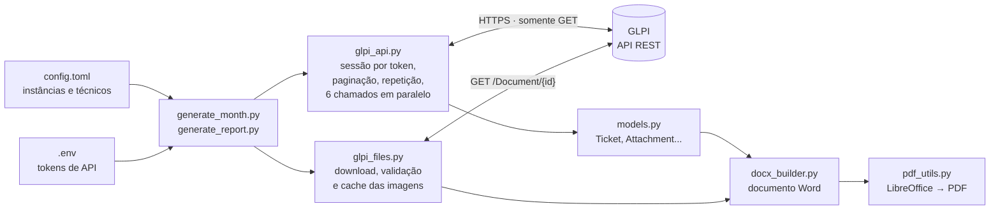
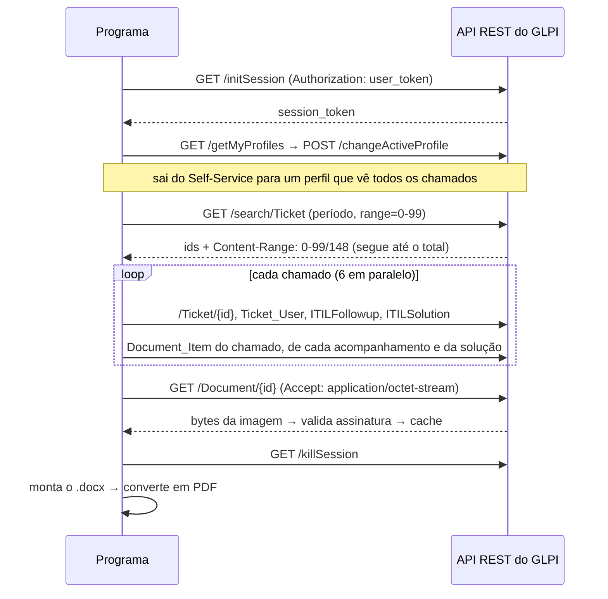

# glpi-evidence-report

[English](README.md) | **Português**

Gera o "book de evidências" mensal de uma equipe de suporte de TI (cada chamado atendido por cada técnico, com histórico, solução e as imagens anexadas) em Word e PDF, direto da API REST do GLPI.


[](https://github.com/JoseEnriq/glpi-evidence-report/actions/workflows/tests.yml)

| Capa com resumo por técnico | Sumário com links | Chamado com linha do tempo e evidências |
|---|---|---|
|  |  |  |

As imagens e o [PDF de exemplo](docs/sample/evidence_report_sample.pdf) foram gerados pelo modo demonstração, com dados fictícios. O book é em português, pensado para equipes brasileiras; o código é em inglês.

## O problema

Equipes que prestam suporte de TI por contrato costumam ter que comprovar, todo mês, os atendimentos feitos: um documento com cada chamado atendido por cada técnico, com histórico, solução e os prints anexados ao longo do atendimento. Montado à mão a partir das telas do GLPI ou dos e-mails de notificação, ele é lento, depende de quem conhece a rotina, e os prints se perdem, principalmente os anexados aos acompanhamentos e à solução, e não ao chamado em si.

## Como funciona

O programa fala com a API REST do GLPI, em modo somente leitura:

1. abre uma sessão com um token de API, sem guardar senha;
2. busca os chamados do período com paginação e traz 6 chamados em paralelo;
3. reúne os anexos do chamado, dos acompanhamentos e da solução, sem duplicar;
4. baixa as imagens para um cache em disco, conferindo a assinatura de cada arquivo;
5. monta o Word com python-docx e converte em PDF com o LibreOffice headless.

Um único comando gera os books do mês anterior de todos os GLPIs configurados, e o `generate_month.bat` permite rodá-lo pelo Agendador de Tarefas do Windows.



O que acontece com um GLPI, do login ao documento:



## Decisões

- **Anexos de três origens.** Os prints costumam estar nos acompanhamentos e na solução, então consulto o `Document_Item` de cada um deles, não só o do chamado.
- **Validar os bytes, não a resposta.** O download de um documento pode voltar como uma página HTML de login ou de erro com status 200. Confiro a assinatura PNG/JPEG/GIF/BMP antes de salvar qualquer coisa como imagem.
- **Confiar no `Content-Range`, não no tamanho da página.** Alguns servidores devolvem páginas menores que as pedidas, então a paginação segue o total informado pelo servidor.
- **Perfil de menor privilégio.** O login costuma cair no Self-Service, que não vê os chamados de outros usuários, então o programa troca para o perfil de menor privilégio que vê.
- **6 threads de propósito.** Cada chamado custa uns 12 pedidos; poucas threads e um cache de usuários e categorias deixam a geração rápida sem sobrecarregar o GLPI.

A tabela completa, com referências ao código, e a organização dos módulos ficam em [docs/arquitetura.md](docs/arquitetura.md#decisões-técnicas).

## Rodar a demonstração

Não precisa de GLPI: um servidor simulado responde na camada HTTP, então o programa real roda inteiro.

```bash
git clone https://github.com/JoseEnriq/glpi-evidence-report.git
cd glpi-evidence-report
python -m venv .venv
.venv\Scripts\activate          # Linux/macOS: source .venv/bin/activate
pip install -r requirements.txt
python demo.py
```

O `.docx` e o `.pdf` ficam em `demo_output/`. O PDF precisa do [LibreOffice](https://www.libreoffice.org/) instalado; sem ele, sai só o `.docx`.

## Usar com o seu GLPI

É preciso ter a API REST habilitada com login por token e um token de usuário com perfil de leitura. Preencha o `config.toml` e o `.env` a partir dos arquivos de exemplo e rode `python diagnose_api.py` para conferir o acesso. Configuração, comandos e problemas comuns estão em [docs/uso.md](docs/uso.md).

## Testes

Rode `pip install -r requirements-dev.txt` e depois `pytest`. Os testes cobrem as funções puras e o fluxo de ponta a ponta contra o GLPI simulado (erro 503 passageiro, página HTML servida como imagem, paginação além do limite do servidor) e rodam no GitHub Actions, em Ubuntu e Windows.
