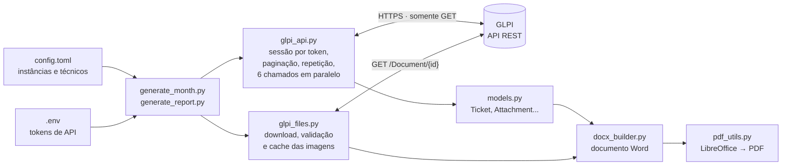
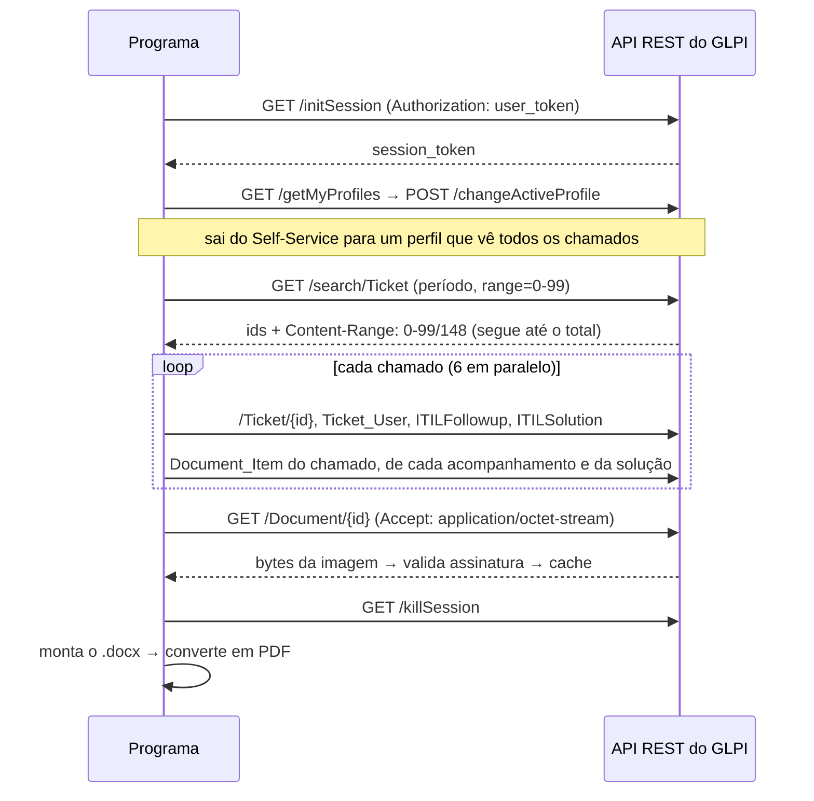

# Arquitetura

Como o programa está organizado, o que acontece em cada chamada à API do GLPI e por que cada decisão técnica foi tomada. Para instalar e usar, veja [uso.md](uso.md).

## Visão geral



## Do login ao documento

O que acontece com um GLPI:



## Decisões técnicas

| Ponto | Como foi resolvido | Onde |
|---|---|---|
| Autenticação | token de API trocado por um `session_token` temporário; nenhuma senha | `glpi_api.ApiClient._authenticate` |
| Perfil sem acesso aos anexos | troca automática do perfil ativo da sessão (Self-Service → perfil central) | `_switch_to_central_profile` |
| Listas grandes | paginação seguindo o cabeçalho `Content-Range`, mesmo que o servidor devolva páginas menores que as pedidas | `ApiClient.get_list` |
| Imagens faltando | anexos do chamado **+** acompanhamentos **+** soluções, sem duplicar | `GlpiSource._attachments` |
| Lentidão (~12 pedidos por chamado) | cache em memória de usuários/categorias + `ThreadPoolExecutor` com 6 threads | `GlpiSource.fetch_tickets` |
| Falhas temporárias | repete erro de rede e 5xx (espera crescente); não repete 4xx; um chamado com erro não derruba o lote | `ApiClient._get`, `fetch_tickets` |
| "Imagem" que é página de erro | confere os bytes iniciais (PNG/JPEG/GIF/BMP) antes de salvar | `image_utils.detect_mime` |
| Downloads repetidos | cache em disco por id do documento (documento do GLPI é imutável) | `glpi_files.DocumentDownloader` |
| Chamados da lixeira | a busca da API já os exclui | `find_ticket_ids` |
| Texto sempre igual entre execuções | participantes ordenados pelo id do vínculo ao chamado | `GlpiSource._actors` |
| Legenda separada da imagem | "manter com o próximo" na imagem; controle de linhas órfãs | `docx_builder._insert_attachments` |
| "Página X de Y" em tamanho diferente | campo do Word montado em partes, todas com a mesma formatação | `docx_builder._insert_field` |
| PDF aberto no leitor | detecta o bloqueio e salva com outro nome | `pdf_utils._move_avoiding_locked_target` |

## Tecnologias

- **Python 3.11+**: `requests`, `python-docx`, `python-dotenv`, `tomllib`, `concurrent.futures`, `dataclasses`.
- **API REST do GLPI**: sessão por token, troca de perfil, busca com critérios, paginação, download de documentos.
- **Word (OOXML)**: além do python-docx, elementos XML criados à mão para bordas, fundos, campos de página, marcadores e links internos.
- **LibreOffice headless**: conversão para PDF sem perda nas imagens, com links e marcadores.
- **pytest**: testes das funções puras e de ponta a ponta contra um GLPI simulado, rodando no GitHub Actions (Ubuntu e Windows, Python 3.11 e 3.12).

## Estrutura

```text
├── generate_month.py / .bat   books do mês de todas as instâncias
├── generate_report.py         fluxo de um book (CLI)
├── glpi_api.py                tudo que fala com a API REST do GLPI
├── glpi_files.py              download das imagens com validação e cache
├── models.py                  modelo de dados e tradução dos códigos do GLPI
├── docx_builder.py            monta o Word (não fala com o GLPI)
├── pdf_utils.py               .docx → PDF via LibreOffice
├── image_utils.py             tipo real da imagem pela assinatura
├── config.py                  leitura do config.toml
├── diagnose_api.py            confere o acesso à API
├── demo.py                    modo demonstração
├── simulator/                 GLPI simulado, dados e imagens fictícios
├── tests/                     pytest
└── docs/                      documentação, prints e PDF de exemplo
```

## GLPI simulado e testes

O modo demonstração e os testes de ponta a ponta usam o mesmo GLPI simulado ([`simulator/fake_glpi.py`](../simulator/fake_glpi.py)). A simulação fica na camada HTTP: um adaptador de transporte do `requests` responde como a API do GLPI, então o programa real roda inteiro, sem atalhos. O simulador reproduz login, troca de perfil, paginação, um erro 503 passageiro e um anexo que devolve HTML em vez de imagem.

Os testes cobrem:

- **funções puras**: paginação, assinatura de imagem, HTML → texto, configuração, filtro por técnico;
- **fluxo de ponta a ponta** contra o GLPI simulado: login e troca de perfil, token recusado, paginação além do limite do servidor, exclusão da lixeira, anexos das três origens, repetição após 503, recusa de HTML como imagem e reaproveitamento do cache.

## Segurança

- **Somente leitura.** Todos os pedidos são `GET`, exceto `initSession`/`killSession` e `changeActiveProfile`, que muda só o perfil ativo da própria sessão e não grava nada no GLPI.
- **Sem senhas.** Só tokens de API, revogáveis a qualquer momento; ficam no `.env`, fora do controle de versão.
- **Menor privilégio.** Recomendada uma conta de serviço com perfil de leitura e o cliente de API restrito ao IP da máquina. Quando o usuário tem vários perfis, o programa escolhe o de menor privilégio que ainda enxerga todos os chamados.
